# WhatsUp Clients

**WhatsApp di desktop, sebagai program native — bukan browser yang memakai ikonnya.**

[English](README.md) · [Bahasa Indonesia](README.id.md)

[](https://github.com/latiefahmad/whatsupclients/actions/workflows/build.yml)
[](https://github.com/latiefahmad/whatsupclients/releases)


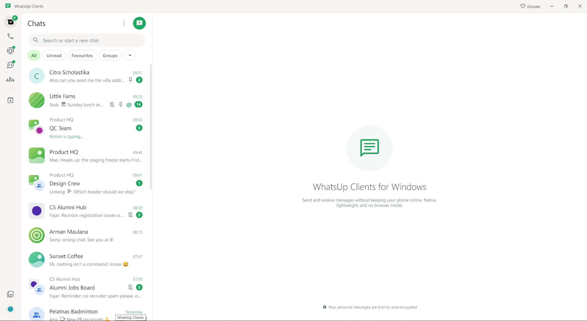

---

## Apa ini

Kebanyakan aplikasi chat desktop membawa mesin browser dan menampilkan satu halaman web di
dalamnya. Yang ini tidak. WhatsUp Clients menggambar setiap pikselnya sendiri di GPU dengan
[Gio](https://gioui.org) dan berbicara langsung ke protokol WhatsApp lewat
[hypermeow](https://github.com/polymorfa/hypermeow).

Pilihan itu memberi satu hal di atas segalanya: **aplikasinya tetap hidup**. Ia berjalan di
tray, menjaga koneksi tetap terbuka, dan terus menyinkronkan semuanya sementara kamu bekerja
— dengan atau tanpa jendela di layar.

## Sinkronisasinya nyata

Bagian yang paling cepat terasa. Ubah sesuatu di HP, dan itu terjadi di sini, tanpa reload:

- **Hapus pesan di HP** → hilang di sini.
- **Edit di sana** → teks hasil editnya muncul di sini.
- **Baca di sana** → notifikasinya hilang di sini.
- **Bersihkan chat di sana** → chat-nya bersih di sini.

WhatsApp mengalirkan perubahan ini lewat kanal pengaturan privat yang diambil dan diputar
ulang oleh tiap perangkat tertaut. Kalau satu kanal macet, aplikasi dulu tetap mengira
dirinya sudah mutakhir, lalu diam-diam berhenti menerima *apa pun* dari kanal itu — termasuk
penghapusan. Sekarang aplikasi memastikan sebuah kanal benar-benar menyimpan sesuatu sebelum
menandainya selesai, dan membuka kembali kanal yang ternyata kosong. Ketika salinan dari
WhatsApp sendiri tidak terpakai, aplikasi meminta salinan baru ke HP-mu, sama seperti
perangkat tertaut WhatsApp lainnya.

## Tetap jalan saat ditutup

- **Tutup jendelanya, aplikasinya tetap ada.** Koneksi tetap terbuka di tray, jadi pesan
  tetap masuk dan notifikasinya muncul. Memori GPU jendela dilepas, lalu kembali saat
  dibuka lagi.
- **Pesan terjadwal terkirim tepat waktu** — walau tidak ada jendela, walau aplikasi cuma
  di tray. `/schedule 21:00 Invoice terlampir` lalu tinggalkan.
- **Balasan AFK menjawab untukmu** selama kamu pergi, sampai kamu sendiri mengirim pesan.
- **Notifikasi masuk seketika**, dengan Reply dan Mark as read di Windows.

## Tangkapan layar

<table>
  <tr>
    <td width="50%">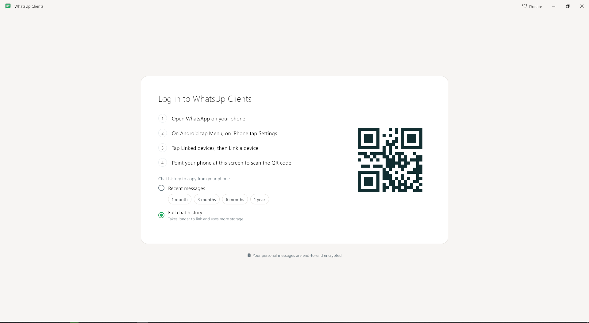</td>
    <td width="50%">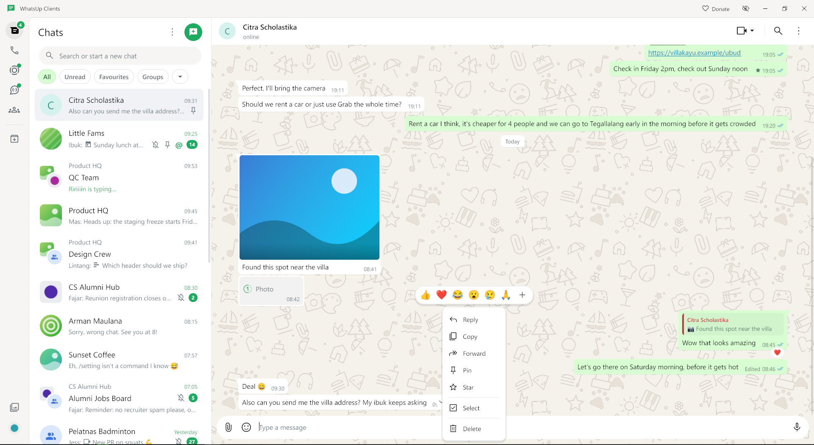</td>
  </tr>
  <tr>
    <td>Tautkan dengan kode QR, seperti WhatsApp Web, dan pilih seberapa banyak riwayat yang diambil.</td>
    <td>Reaksi, balas, teruskan, pin, bintang, pilih, dan hapus — semua dari satu klik kanan.</td>
  </tr>
  <tr>
    <td>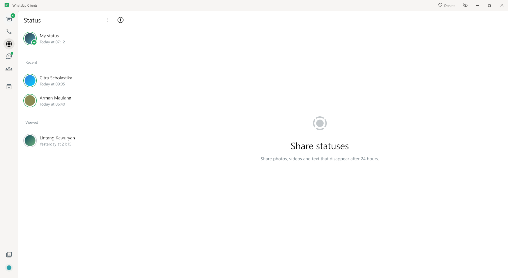</td>
    <td>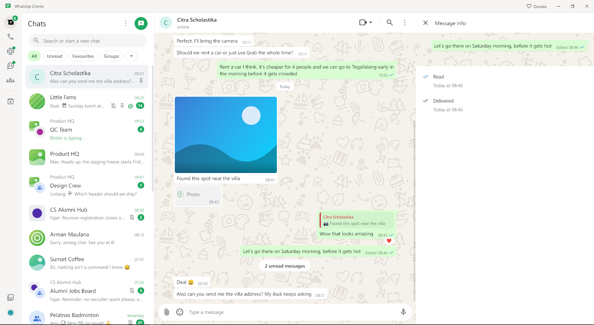</td>
  </tr>
  <tr>
    <td>Lihat dan pasang status: teks, foto, dan video, dengan daftar audiensmu sendiri.</td>
    <td>Info pesan menunjukkan siapa saja yang menerima pesanmu, dan kapan.</td>
  </tr>
  <tr>
    <td>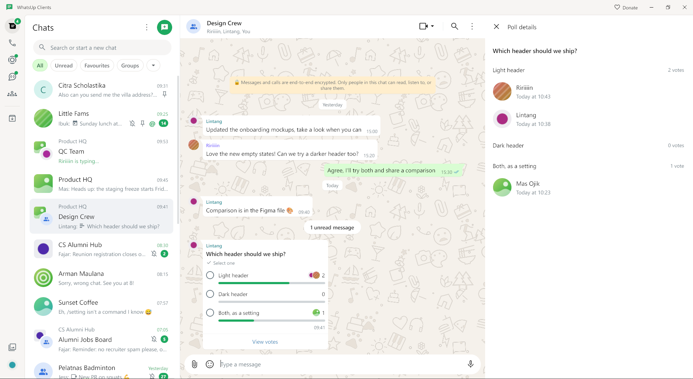</td>
    <td>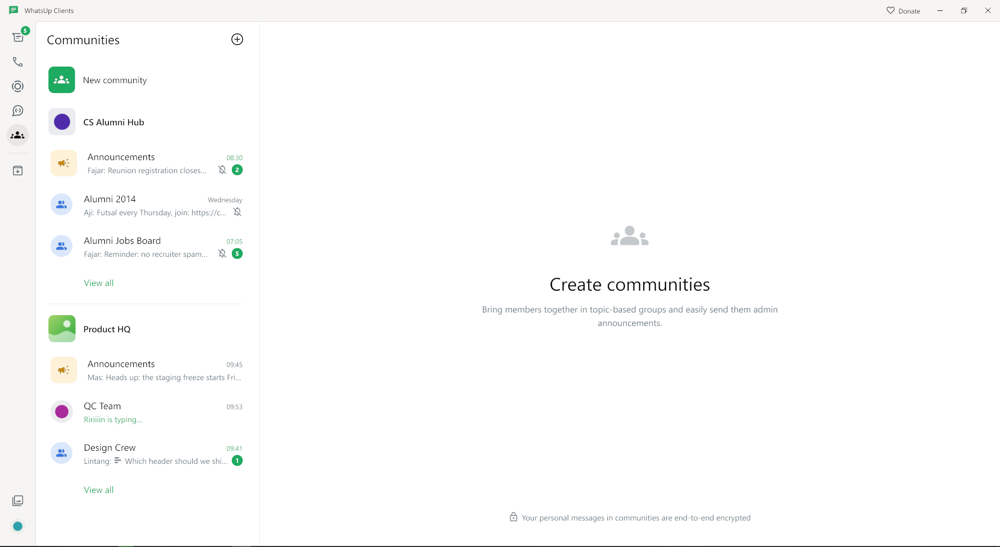</td>
  </tr>
  <tr>
    <td>Ikut polling dengan satu klik, dan lihat siapa memilih apa.</td>
    <td>Komunitas beserta pengumuman dan grupnya, serta kanal yang bisa diikuti.</td>
  </tr>
</table>

## Sudah ada di dalamnya

- Dua tampilan: **semua chat dalam satu daftar**, atau terbagi dengan percakapan.
- **Draf** yang menempel di tiap chat, **@mention**, dan format tebal / miring / coret / kode.
- **Pesan suara dan video** diputar oleh decoder bawaan OS — tanpa codec yang dibundel.
- Chat **di-pin, diarsipkan, dan dibisukan**, favorit, daftar khusus, pesan sementara, tema chat.
- **Album dan dokumen**, pratinjau tautan dengan gambar besar ala WhatsApp, tautan undangan grup.
- Pesan **sekali lihat** yang terbuka sekali, dengan tangkapan layar diblokir selama terbuka.
- **Beberapa akun**, dan hanya yang sedang dibuka yang tersambung, agar memori tetap hemat.
- **Tema terang dan gelap**, wallpaper doodle WhatsApp, dan System default yang mengikuti OS.
- **Ukuran font** 70% sampai 200%, dengan Ctrl + `+` / `-` / `0`.
- **Update dari rilis GitHub yang ditandatangani**, dicek otomatis dan ditawarkan sebagai
  *Update now* atau *Later*.

Memori adalah alasan proyek ini ada. Cache dibatasi berdasarkan ukuran, bukan jumlah entri,
dan setelah sepuluh detik tanpa aktivitas aplikasi mengembalikan memori ke OS.

## Di luar yang disediakan WhatsApp

Semua fitur di bawah ini **mati sampai kamu nyalakan** di *Settings > Extra features*.
Masing-masing hanya memakai yang memang sudah boleh dilakukan setiap perangkat tertaut.

### Slash command

Ketik `/` dan muncul pemilih di atas kolom pesan. Admin grup mendapat perintah pengelolaan
tanpa membuka satu menu pun.

<table>
  <tr>
    <td width="50%">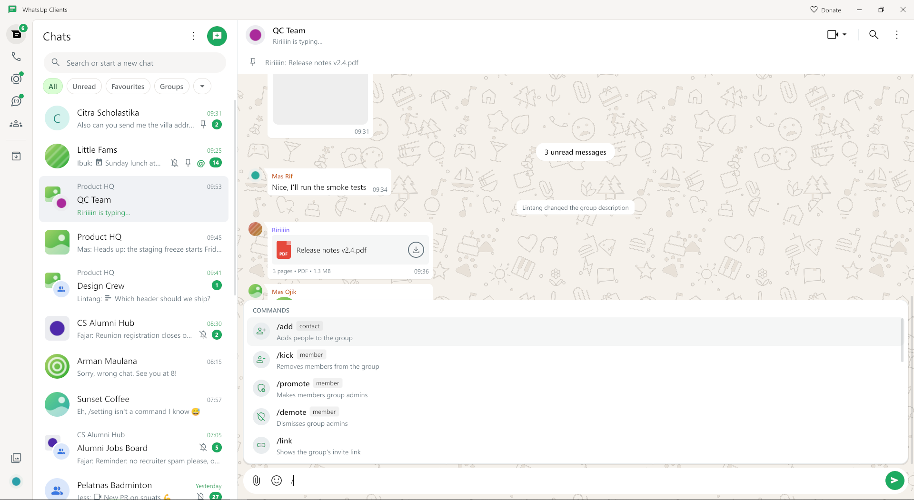</td>
    <td width="50%">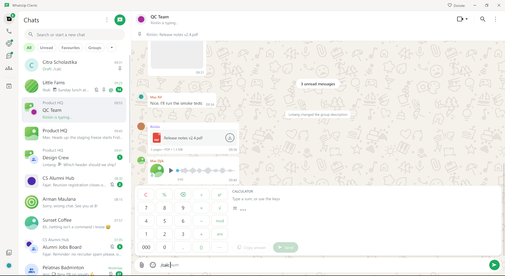</td>
  </tr>
  <tr>
    <td>Pemilihnya menampilkan yang boleh di chat itu, dan menerima Tab, panah, serta Enter.</td>
    <td><code>/calc</code> menghitung sambil kamu mengetik, dan mengambil angka dari pesan yang kamu balas.</td>
  </tr>
</table>

| Perintah | Fungsinya |
| --- | --- |
| `/add <kontak>` | Menambahkan orang ke grup |
| `/kick <anggota>` | Mengeluarkan anggota |
| `/promote` / `/demote <anggota>` | Menjadikan admin, atau mencabutnya |
| `/link` | Menampilkan tautan undangan grup |
| `/lockdown on\|off` | Hanya admin yang boleh kirim, atau semua lagi |
| `/description <teks>` | Mengubah deskripsi grup |
| `/sticker atas#bawah` | Mengubah foto jadi stiker, lengkap dengan teks meme |
| `/purge <jumlah>` | Menghapus pesan terakhirmu untuk semua orang |
| `/raffle <jumlah>` | Mengundi anggota grup secara acak lalu mengumumkannya |
| `/calc <hitung>` | `12 x 4500`, `15k x 3`, `15% x 80000` |
| `/schedule <waktu> <pesan>` | `21:00`, `2h`, `tomorrow 08:00`, `fri 18:00` |
| `/scheduled` | Menampilkan yang terjadwal di chat itu: kirim sekarang, atau batal |
| `/afk <alasan>` | Menjawab untukmu sampai kamu mengirim pesan; batasi di *Settings > AFK list* |
| `/ghost` | Tanpa centang baca, tampil offline, tidak mengirim — fitur yang secara etika abu-abu |
| `/snippet send <nama>` | Mengirim pesan yang tersimpan |
| `/snippet save [nama atau teks]` | Menyimpan pesan yang kamu balas, atau teksnya sendiri |
| `/catch` | Membuka payload tersimpan dari pesan yang kamu balas |

### Snippet

Simpan pesan yang sering kamu kirim di *Settings > Snippets*, lalu kirim lewat
`/snippet send`. Pemilihnya menawarkan snippet sambil kamu mengetik. Teksnya bisa memuat
variabel yang diisi saat dikirim: `{name}`, `{first}`, `{mention}`, `{chat}`, `{me}`,
`{quote}`, `{greeting}`, `{date}`, `{time}`, dan `{day}`. `{...}` yang tidak dikenal
dibiarkan apa adanya; `\{name}` mengirimnya apa adanya.

### Privasi, untuk saat ada yang mengintip

<table>
  <tr>
    <td width="50%">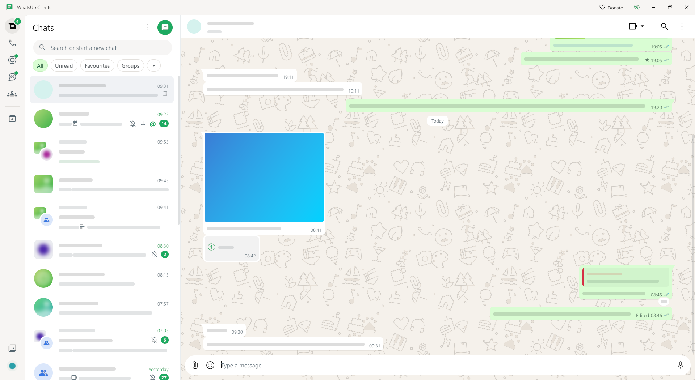</td>
    <td width="50%">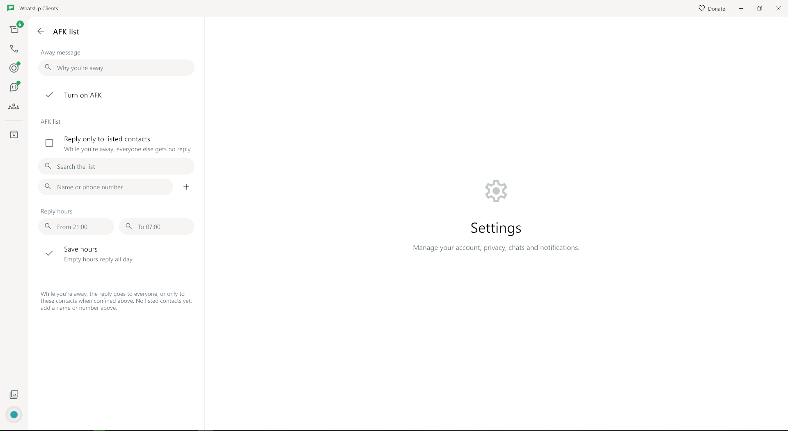</td>
  </tr>
  <tr>
    <td><b>Mode privasi</b>: nama dan pesan berubah jadi balok, gambar diburamkan, semuanya sampai kamu menunjuk. Ctrl+Shift+P, atau ikon mata di title bar. <b>Block screen recording</b> menjauhkan jendela dari rekaman layar.</td>
    <td><b>Daftar AFK</b> membatasi siapa yang dapat balasan otomatis, dan pesan terjadwal menunggu di chat sampai waktunya tiba.</td>
  </tr>
</table>

### Fitur yang secara etika abu-abu

Halaman tersendiri, masing-masing dengan sakelar dan peringatannya sendiri:

- 🗑️ **Keep deleted messages** — pesan dan status yang dihapus untuk semua orang tetap ada, ditandai Deleted.
- 👁️ **Replay view once** — buka pesan sekali lihat sesering yang kamu mau.
- 👻 **`/ghost`** — baca chat dan status tanpa jejak.

Menyalakan salah satunya memunculkan peringatan soal ekspektasi privasi. Kamu harus
mencentang pernyataannya dan memilih **Enable feature** sebelum aktif. Mematikannya
langsung berlaku; menyalakan lagi akan bertanya ulang.

## Unduh

Ambil versi terbaru di [Releases](https://github.com/latiefahmad/whatsupclients/releases).
Paket siap pakai untuk **Windows** (amd64) dan **Linux** (amd64) terlampir di setiap rilis.

- `WhatsUpClients-Setup.exe` — memasang hanya untuk penggunamu. Tidak perlu hak admin.
- `WhatsUpClients-windows-amd64.exe` — aplikasi yang sama, tanpa installer.
- `WhatsUpClients-linux-amd64` — binary untuk Linux.

Untuk memperbarui, gunakan *Settings > Help > Check for updates*. Aplikasi juga memeriksa
sendiri sesaat setelah mulai dan setiap empat jam, lalu menawarkan tiap rilis sekali. Setiap
rilis membawa bagian [CHANGELOG](CHANGELOG.md)-nya sebagai catatan rilis.

## Coba dulu tanpa akun

Mode demo menjalankan aplikasi dengan chat palsu dan tanpa jaringan. Semua tangkapan layar
di atas berasal dari sana.

```sh
go run ./cmd/whatsup -demo
```

## Bangun sendiri

Kamu perlu versi Go yang ada di `go.mod`. Di Linux, pasang dulu
[dependensi sistem](https://gioui.org/doc/install/linux) Gio.

```sh
sh patches/apply.sh                 # sekali setelah clone: membangun go-text yang dipatch
go run ./cmd/whatsup                # jalankan, lalu tautkan dengan kode QR
go run ./cmd/whatsup -demo          # chat palsu, tanpa jaringan
go run ./cmd/whatsup -background    # mulai di tray, tanpa jendela
go run ./cmd/whatsup -debug         # catat lalu lintas protokol
go build ./...
```

Datamu ada di `%AppData%\WhatsUpClients\whatsup.db` di Windows, dan di direktori konfigurasi
pengguna di sistem lain.

## Bagaimana bagian-bagiannya menyatu

```
cmd/whatsup/        aplikasinya
cmd/screenshot/     merender UI ke PNG, atau di samping tangkapan WhatsApp asli
cmd/memprobe/       tolok ukur memori dan waktu frame (Windows)
internal/model/     yang dilihat UI: chat, pesan, event, antarmuka Backend
internal/ui/        antarmuka Gio, dari daftar chat sampai kolom pesan
internal/wa/        backend hypermeow dan penyimpanan pesan SQLite
internal/command/   slash command
internal/auto/      pesan terjadwal dan balasan AFK
internal/sticker/   pembuat stiker, dengan encoder WebP lossless sendiri
internal/video/     video dan audio lewat decoder OS
internal/notify/    notifikasi sistem
internal/desktop/   tray, mulai saat login, satu instance
internal/update/    update mandiri yang ditandatangani
internal/mock/      backend demo
```

UI tidak pernah menyentuh tipe protokol. `internal/wa` mengubah event hypermeow menjadi
event `internal/model`, dan UI mengambilnya di goroutine-nya sendiri, jadi state UI tidak
perlu lock.

## Berkontribusi

Baca [AGENTS.md](AGENTS.md) lebih dulu. Isinya konvensi dan jebakan Gio yang ditemukan
dengan susah payah. Memori rendah adalah inti proyek ini, jadi ukur dengan `cmd/memprobe`
sebelum dan sesudah perubahan. Jalankan `gofmt`, `go vet ./...` dan `go build ./...` sebelum
mengirim.

## Lisensi

[MIT](LICENSE).

## Penyangkalan

Tidak resmi. Tidak berafiliasi dengan atau didukung oleh WhatsApp maupun Meta. Memakai
klien pihak ketiga bisa melanggar Ketentuan Layanan WhatsApp, jadi gunakan dengan risiko
sendiri.
